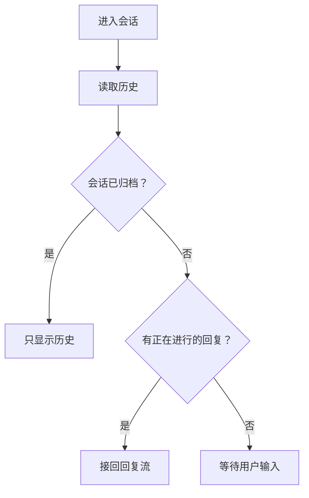

# Writing Code Comments

This skill does one thing: read the code you are given and write its comment. It never decides whether a comment should exist, never deletes one, and never changes or suggests changes to the code. The result is always a comment, and the comment describes the code; it never speaks to the person who asked.

## Called With a Code Range

Arguments for this call: `$ARGUMENTS`

When the arguments start with `<path>:<start>-<end>`, the call comes from the code-reading preview, for example `/ecc:writing-code-comments backend/src/app/acquisition/repository.py:13-60`. Words after the range are the user's request for this comment. The preview writes your answer into the file itself. Every rule below still applies, plus these:

- `<path>` is relative to the working directory, the repository root. Lines count from 1. The range is one code block (a class, a function, a statement) together with the comments already above it. For a file-header comment, the range is that comment itself.
- Read those lines yourself. Read more of the file, or other files, when the comment needs context.
- Write the one comment the preview replaces. The range tells which one:
  - **The block's own doc comment**, when it has one: a Python docstring as the first statement of the function or class, or a `/** */` or `///` comment right above the declaration. Write a doc comment, with `@param` / `@return` / `@throws` tags where they apply.
  - **The plain comment** that opens the range (`#`, `//`, `/* */`), when the block has no doc comment. Write a plain comment.
  - **A new comment**, when the range has neither. The preview adds a doc comment to a declaration that takes one: a docstring for a Python function or class, `/** */` for a TypeScript or JavaScript function, class, enum, constant, or variable, `///` for a Rust item. Anything else gets a plain line comment (`#` or `//`). Write that kind.
  - A file-header comment stays a file-header comment.
- A front-end component's doc comment carries its own picture, as in Front-End Components. Embed the PNG the export script writes under `docs/prototype/<feature>/openpencil/exports/`.
- Your tools: Read, Grep, and Glob in the working directories; Bash for OpenPencil's `op` and for `uv run ${CLAUDE_SKILL_DIR}/scripts/export-component.py`; Write and Edit only under `docs/prototype/<feature>/openpencil/`. Everything else is refused: no source file can be changed and no other command runs. Do not look for a way around it.
- Write it in Chinese. Code names, parameter names, literals, and links stay as they are in the code.
- Write the comment and nothing else: no Chinese name marks (`@Comment`), no code changes.
- The answer is the comment body only: no `#`, `//`, `/* */`, `/** */`, leading ` * `, or `"""`, no indentation added around the body, no outer code fence, nothing before or after it. Fenced `mermaid` blocks inside the body are required for complex flows; preserve their fences, line breaks, and diagram indentation. The preview puts it in the `body` field of its structured output and writes it into the file with the right comment syntax.
- Before answering, run the checks in Before You Finish on the body. Check each reference with Grep.
- Later messages in the same session are the user's requests to change this comment. Each starts with the block's current `<path>:<start>-<end>`, because the lines move once the preview writes a comment. Read the range again, make the change, and answer with the whole new body the same way.

## Explaining Code: One Plain Sentence

Explain code the Feynman way: say what it does and why in one sentence, in plain words a newcomer to the codebase understands.

- One sentence. For a doc comment, that sentence is the summary line.
- Everyday words. A term the reader may not know gets replaced, or explained in the same sentence.
- Say the why, not the mechanics. The code already shows the mechanics.
- If one plain sentence will not come, the code is not understood yet, or it does too much. Read it again or split it before writing the comment.

```python
# Bad: jargon, no reason
# CAS-based conditional delete leveraging Lua atomicity to mitigate stale-holder races.

# Good: plain words, the reason included
# Delete the lock only if it is still ours, so a holder whose lock expired cannot delete someone else's.
```

### Complex Flows: Use Mermaid, Not Prose

When explaining a complex flow, keep the one-sentence summary of its purpose, then describe the flow with a fenced `mermaid` diagram. Do not write the flow as a paragraph or a numbered list, and do not repeat the diagram in prose. Simple behavior that fits in the summary needs no diagram.

- **Use a diagram when behavior depends on interacting branches, state transitions, or asynchronous ordering**, such as queueing, retries, reconnecting, or resuming work. Do not turn every implementation step into a node.
- **Choose the diagram that makes the behavior clear.** Use `flowchart TD` for decisions and branches, `stateDiagram-v2` for state transitions, or `sequenceDiagram` for interactions over time. Split independent flows into small diagrams when one would become crowded.
- **Derive every node and edge from the code you read.** Show the relevant entry, branch conditions, outcomes, and any actual retry or resume path. Do not invent behavior from the old comment or from this example.
- **Use short, plain Chinese labels in preview comments.** Quote flowchart labels and label decision edges. Use neutral IDs such as `A` and `B`; these are diagram syntax, not code references. Keep code references and their KDoc links outside the diagram, in a brief note only when needed.
- **Embed Mermaid source directly in the comment body.** Do not export an image or wrap the whole answer in a code fence. Outside the diagram, retain only the summary, necessary reasons or constraints, and applicable `@param` / `@return` / `@throws` tags.

Example comment body for a function whose code actually implements these branches:

````markdown
按会话状态恢复聊天，让刷新后的页面接上仍在进行的回复。


````

## Rewriting a Comment: Start From the Code

When asked to rewrite a comment, do not edit the old one. Ignore it, read the code, and write what is true now from scratch. An old comment carries stale facts, restated code, and wrong summaries; editing it keeps them.

Then check what you wrote:

- **The summary is true.** No neat word the code does not live up to, such as "one-to-one" for code that never deletes.
- **Nothing restates the code.** A condition written out in words adds nothing. When a value has a hidden meaning (`owner_id is None` means a platform row), say it on that line.
- **Each note sits where it applies.** A condition's meaning goes next to the condition, not into the module summary.
- **Nothing describes other modules.** What another page or service does goes stale here when it changes.

Before, a module docstring rewritten by changing only its format:

```python
"""Keep the `agent` table one-to-one with `vendor/agents/<slug>/agent.yaml` at startup.

Add only, never delete: rows whose yaml was removed stay (the admin page marks them
"definition missing"), to avoid deleting user data. Rows with `owner_id` were created by
users, leave them; platform rows (`owner_id` is `None`) refresh description and tags from yaml.
"""
```

After, written from the code:

```python
"""At startup, sync the [agent definitions](vendor/agents) into the [agent table](backend/src/app/agent/models.py#Agent); it adds and updates but never deletes rows, because a row may carry user data."""

        elif row.owner_id is None and (...):  # platform rows only; rows users created stay as they are
```

## Comment Format: KDoc Markdown in Every Language

Write every comment the way Kotlin KDoc does, whatever the language. Python, TypeScript, Java, and the rest all follow it; do not use a language's own doc format.

- Backticks for parameter names, literals, and commands, e.g. `token`, `None`, `GET`.
- Square brackets for classes, functions, members, and exceptions defined in this file or imported into it, as in KDoc: `[UserRole.ADMIN]`, `[get_user]`, `[LocalRuntimeDisabled]`.
- Links for code anywhere else in the repo: other modules, files, directories, tables. See Links to Code in the Repo.
- Block tags: `@param name description` (the bare parameter name), `@return description`, `@throws [ExceptionClass] when it is thrown` (a full link when the exception is neither defined nor imported here). No types; the signature carries them.
- The first sentence of a doc comment is the summary. Leave one blank line, then the details; details may use lists, bold, and code blocks.
- Line comments (`#` / `//`) use the same backticks, square brackets, and links.

Never use: reST `:param x:` and double backticks, Google-style `Args` / `Returns` sections, Javadoc HTML tags and `{@link}` / `{@code}`, JSDoc `{Type}`.

One function, same structure in three languages:

```kotlin
/**
 * Releases the session lock held by `token`.
 *
 * Deletes only when the `GET` value equals `token`, so an old holder whose lock expired cannot delete the new lock.
 *
 * @return `true` if deleted; `false` if the lock now belongs to someone else
 */
fun release(sessionId: String, token: String): Boolean
```

```python
def release(session_id: str, token: str) -> bool:
    """Releases the session lock held by `token`.

    Deletes only when the `GET` value equals `token`, so an old holder whose lock expired cannot delete the new lock.

    @return `True` if deleted; `False` if the lock now belongs to someone else
    """
```

```ts
/**
 * Releases the session lock held by `token`.
 *
 * Deletes only when the `GET` value equals `token`, so an old holder whose lock expired cannot delete the new lock.
 *
 * @return `true` if deleted; `false` if the lock now belongs to someone else
 */
function release(sessionId: string, token: string): boolean
```

### Links to Code in the Repo

Code a comment names that is neither defined in nor imported into this file is a Markdown link: a directory, a file, a table, a class or function in another module. A backtick name only looks like code; a link takes the reader there.

- Format: `[plain name](path/from/repo/root#Symbol)`.
- The path is relative to the repository root, with no leading `./` or `/`.
- `#Symbol` names a class, function, or member in that file: `#Agent`, `#Agent.owner_id`, `#sync_agent_rows`. Leave it off for a directory or a whole file.
- Never a line number. Lines shift with every edit above them; a symbol name does not.
- The link text is the plain name a reader understands: `agent table`, not `agent`.
- Names defined in or imported into this file stay `[Name]`, as in KDoc. The code-reading preview resolves them the same way: this file first, then its imports.

```python
# Bad: names the reader has to go and find
# Syncs `vendor/agents` into `agent`.

# Good: each one opens the code it names
# Syncs the [agent definitions](vendor/agents) into the [agent table](backend/src/app/agent/models.py#Agent).
```

## Front-End Components: Show What It Looks Like

A front-end component's doc comment embeds a picture of the component, right after the summary sentence. The reader sees at a glance which part of the screen the code draws: the page from its OpenPencil prototype, dimmed except for this component, which is framed and tagged with its name.

```tsx
/**
 * Top bar: the logo on the left, the main links in the middle, the start button on the right.
 *
 * 
 */
export function SiteNav() {
```

- **Only what the reader can see.** A component that draws nothing of its own (a provider, a context wrapper, a hook) gets no picture.
- **Nodes carry markers.** A node names the component it draws after ` · `: the file path from the repo root, `#`, and the component's name, as in `top bar · src/components/marketing/SiteNav.tsx#SiteNav`. A node drawn by several components carries one marker for each, each after its own ` · `. The export script finds a component by its marker alone.
- **Mark what the component draws.**
  - The whole page, as a page entry or a layout around the whole page does: the board's title carries the marker, and the picture is the whole board with no frame.
  - One area: the node that covers exactly that area.
  - Several areas, as a shell with a top bar and a footer, or a card repeated in a list: every one of those nodes, each framed in the same picture.
  - Nothing on the usual board, as a dialog or an open menu: add a board for that state, the usual desktop page with it open, and mark the dialog or menu node there.
- **Reuse the prototype that names this file.** Look only under `docs/prototype/*/openpencil/` (`build.js` and the `.op`). Ignore `figma-plugin/`. It counts when a marker, a board's title, or the note that introduces a board names this component's file path from the repo root. The same words on a menu item or a button do not count. Do not redraw the page.
- **No marker yet: add it to `build.js`, then rebuild the `.op`.** Append the marker to the names of the nodes this component draws, or add the state board above. Change nothing that is drawn: the rebuilt page looks as it did. Rebuild as in Drawing With `op`.
- **Export with the script.** `${CLAUDE_SKILL_DIR}/scripts/export-component.py` reads the board through `op`, dims everything but the marked nodes, frames and tags each, and keeps one screen centred on them, as wide as the board and 900 high, taller when they do not fit. It writes `docs/prototype/<feature>/openpencil/exports/<board>--<Component>.png`, or `exports/<board>.png` when the marker is on the board's title, and prints the path. The comment embeds that path from the repo root: ``. `<board>` names the board the marker is on: `desktop` for the usual desktop board, a name of its own such as `login` for a state board. Exporting again overwrites the PNG. `${CLAUDE_SKILL_DIR}` is the directory of this SKILL.md. When the script path in a command does not start with `/`, replace everything before `/scripts/` with the absolute path of that directory.
- **No prototype names this file: draw the page in a new directory.** Create `docs/prototype/<feature>/openpencil/` with `build.js` and `<feature>.op`. `<feature>` is what the page does, in the same style as `my-apps`, not the component's class name. Do not start a second prototype of a page that has one. Mark this component's nodes as above. A later call finds the marker and will not draw again.
- **Draw it from the code.** Read the component and the theme it uses: design tokens, Tailwind config, CSS variables. Structure, fixed text, colors, spacing, and corner radii come from there; copy fixed text verbatim. Text that comes from props or data gets made-up sample content that looks real. One desktop board of the page in its usual state, plus a state board only for a component that board does not show. Not a cropped component and not a phone board: the script frames the component on the whole page.

### Drawing With `op`

Drive `op` the way the `ui-prototyping` skill does: read its [OpenPencil route](../ui-prototyping/references/openpencil.md) and the design reference it bundles, then follow steps 1 to 7 with these changes:

- The files live at `docs/prototype/<feature>/openpencil/`: `build.js`, `<feature>.op`, and `exports/`. Never a temporary directory.
- Run `op status` first. An editor that is already running is not yours: it may be the user's or another session's, and `op start` only hands it back, whatever it has open. Do not stop it, and do not delete, design, or save in it. Export from it only when `op get --depth 1` lists this prototype's boards and no rebuild is needed; otherwise ask the user to close it, or, called from the preview, leave the picture out. `op stop` only an editor you started.
- `build.js` is the source of the `.op`. Rebuild the `.op` only when `build.js` is new or changed: delete every board `op get --depth 1` lists (a new file has none), run `op design` on `build.js`, run `op design:refine` on each board it prints, then save. Otherwise do not run `op design` and do not save.
- Export every picture with the script, not with `op export`.
- Skip step 8. Do not open the drawing in the editor.

```bash
OP=/Applications/OpenPencil.app/Contents/MacOS/op
export OPENPENCIL_DESKTOP_BIN=/Applications/OpenPencil.app/Contents/MacOS/openpencil-desktop
"$OP" status                          # already running: not yours, see above
"$OP" start --headless --file "$PWD/docs/prototype/<feature>/openpencil/<feature>.op" > /tmp/openpencil-start.log 2>&1 &
"$OP" get --depth 1
# only when build.js is new or changed: rebuild the .op
"$OP" delete <id>                     # each board listed above
"$OP" design @"$PWD/docs/prototype/<feature>/openpencil/build.js"
"$OP" design:refine --root-id <id>    # each board op design printed
"$OP" layout --depth 2
"$OP" save "$PWD/docs/prototype/<feature>/openpencil/<feature>.op"
# every time: one picture per component
uv run ${CLAUDE_SKILL_DIR}/scripts/export-component.py docs/prototype/<feature>/openpencil desktop <path>#<Component>
"$OP" stop                            # only an editor you started
```

After a new drawing, look at the pictures and fix `build.js` until the page matches the code. After adding markers, the page looks as it did; only the frames are new.

#### From the Code-Reading Preview

Called with a code range, every Bash command is checked as written, so the commands above change:

- Call `op` by its full path and the script as `uv run ${CLAUDE_SKILL_DIR}/scripts/export-component.py`, one command per Bash call: no shell variables, `export`, redirects, `&`, `&&`, or `;`. This `op` finds the desktop app next to it without `OPENPENCIL_DESKTOP_BIN`. `op start --headless` returns as soon as the editor is up.
- Write `build.js` with the Write tool at `docs/prototype/<feature>/openpencil/build.js`, or Edit it there to add markers. The `.op` stays in that directory. Leave both.
- Node does not run here: instead of trying `build.js` under Node first, check that `op design` printed one root id for each board. With the markers already in place, do not run `op design`.
- Every repo path is relative to the repository root, as in the commands below. No absolute path besides the script's, no `$PWD`, and no `cd`. Do not copy the `$PWD` examples from Drawing With `op`.

Markers already in place:

```bash
/Applications/OpenPencil.app/Contents/MacOS/op status
/Applications/OpenPencil.app/Contents/MacOS/op start --headless --file docs/prototype/<feature>/openpencil/<feature>.op
/Applications/OpenPencil.app/Contents/MacOS/op get --depth 1
uv run ${CLAUDE_SKILL_DIR}/scripts/export-component.py docs/prototype/<feature>/openpencil desktop <path>#<Component>
/Applications/OpenPencil.app/Contents/MacOS/op stop
```

New or changed `build.js`:

```bash
/Applications/OpenPencil.app/Contents/MacOS/op status
/Applications/OpenPencil.app/Contents/MacOS/op start --headless --file docs/prototype/<feature>/openpencil/<feature>.op
/Applications/OpenPencil.app/Contents/MacOS/op get --depth 1
/Applications/OpenPencil.app/Contents/MacOS/op delete <id>
/Applications/OpenPencil.app/Contents/MacOS/op design @docs/prototype/<feature>/openpencil/build.js
/Applications/OpenPencil.app/Contents/MacOS/op design:refine --root-id <id>
/Applications/OpenPencil.app/Contents/MacOS/op layout --depth 2
/Applications/OpenPencil.app/Contents/MacOS/op save docs/prototype/<feature>/openpencil/<feature>.op
uv run ${CLAUDE_SKILL_DIR}/scripts/export-component.py docs/prototype/<feature>/openpencil desktop <path>#<Component>
/Applications/OpenPencil.app/Contents/MacOS/op stop
```

## Before You Finish: Check Every Comment You Wrote

Writing comments one by one drifts: the third one gets a link, the fourth one does not. Before saying the work is done, go over every comment written or changed in this task, not a sample, and check each rule:

1. **Every name of code is a reference.** Classes, functions, members, exceptions, files, directories, tables, including names after `@throws`: `[Name]` when defined in or imported into this file, otherwise `[plain name](path#Symbol)`. No bare names, no backtick names.
2. **Every reference resolves.** Each `[Name]` is defined in or imported into its file. Each link's file exists and its `#Symbol` is defined there (`grep -n "class Symbol\|def Symbol\|function Symbol" path`). No line numbers.
3. **Parameters, literals, and commands are in backticks.** The name after `@param` stays bare.
4. **The summary is one plain, true sentence.** Nothing restates the code.
5. **Front-end components carry their own picture** from the export script: `docs/prototype/<feature>/openpencil/exports/<board>--<Component>.png` with the component framed, or `exports/<board>.png` for a component that draws the whole page. A prototype that already names this file is reused, not redrawn.

For every complex flow, also check that its explanation is a fenced `mermaid` diagram, not prose. Trace the branches and transitions against the code, check that node IDs and fences are complete, and remove prose that repeats the diagram. Mermaid node IDs and shape delimiters are diagram syntax, not KDoc references; exclude diagram blocks from the reference checks below. When called from the preview, keep the Mermaid fence inside the body with no outer fence around the answer.

List the bare `[Name]` references mechanically, then confirm each one is defined in or imported into its file; code such as `items[i]` also matches:

```bash
git diff -U0 | grep '^+' | grep -nE '\[[A-Za-z_][A-Za-z0-9_.]*\]([^(]|$)'
```

Fix every miss before reporting the work as finished.

## Chinese Name Marks: `@Comment`

The Superpowers extension's code-reading preview renders code in Chinese. Give a name a Chinese name, and the preview shows it wherever the name is used (hover shows the original). For example, `if current_user.role != UserRole.ADMIN` reads as 「如果 当前用户.role 不等于 用户角色.管理员」. A class name is rendered only when the class carries a mark.

A mark is not an explanation. It is a **name lookup table**: the name only, no description. Explanations still go in normal comments and docstrings.

### How to Write (on the Definition Only, Never at Use Sites)

**Rule: if code can carry the mark, do not use a comment.** A code mark fails loudly when wrong, follows renames, and disappears with the definition. A comment mark fails silently, and an unrecognized one stays in the code as clutter. Use a comment mark only where the language has no place for a code mark.

**Python**

```python
from app.core.naming import Comment                    # the project's no-op Comment (see below)

@Comment("查询用户")
async def get_user(
    user_id: Annotated[Int4Path, Comment("用户编号")],
    current_user: Annotated[User, Comment("当前用户")] = Depends(get_current_user),
) -> UserDetailResponse: ...

@Comment("用户角色")
class UserRole(str, enum.Enum):
    ADMIN = "admin"                                    # @Comment 管理员
    USER = "user"                                      # @Comment 普通用户

MAX_RETRY: Annotated[int, Comment("最大重试次数")] = 3
```

- Parameters, variables, class fields: `Annotated[Type, Comment("name")]`.
- Functions and classes: decorator `@Comment("name")`.
- **Enum members only** use a trailing `# @Comment name`, because `ADMIN = "admin"` has no place for a code mark.
- Keep one no-op `Comment` in the project, shared by the decorator and `Annotated`:

  ```python
  def Comment(name: str):                              # read only by the code-reading preview; returns the target unchanged
      def mark(target):
          return target
      return mark
  ```

**TypeScript / JavaScript**

- Classes, methods, method parameters, constructor parameters: decorator `@Comment("name")`.
- Plain function parameters, variables, and enum members have no code form; use a trailing `// @Comment name`.

**Fallback not to rely on**: with no mark, the preview takes the first clause (12 characters at most) of the docstring `Args:` / `:param x:` entry or the JSDoc `@param` entry as the Chinese name. It exists for old code. New names always get an explicit mark as above. Write parameter descriptions for their own sake; never reword them to produce a Chinese name.

### When to Add

- **Add**: domain nouns, names that recur across the file (`current_user`, `tenant_id`), enum members, abbreviations and jargon (`bps`, `slot`, `acks_late`), and any name that does not map to Chinese at a glance.
- **Skip**: obvious names (`i`, `name`, `url`), locals used once or twice, and names that mean the same as their type (`user: User`).
- Keep names **short**: a noun phrase of 2–6 Chinese characters, 12 at most, with no punctuation and no explanation.

### Relation to Comment Cleanup

- A Chinese name mark is not a comment that restates code. Do not delete it.
- When cleaning a docstring, still delete entries that only restate a parameter's name or type. If such an entry holds a useful Chinese name, **move it into a code mark** (Python parameters: `Annotated[…, Comment("…")]`) instead of dropping it.
