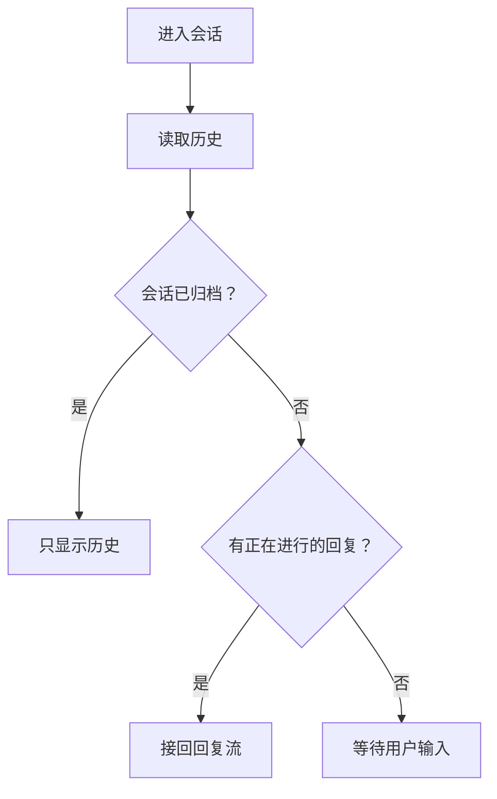

# 编写代码注释

这个技能只做一件事：阅读你被给予的代码并写出它的注释。它从不决定注释是否应该存在，从不删除注释，也从不更改或建议更改代码。结果总是一条注释，并且注释描述代码；它从不与提问者说话。

## 使用代码范围调用

本次调用的参数：`$ARGUMENTS`

当参数以 `<path>:<start>-<end>` 开头时，调用来自代码阅读预览，例如 `/ecc:writing-code-comments backend/src/app/acquisition/repository.py:13-60`。范围之后的文字是用户对这条注释的请求。预览会将你的回答写入文件本身。以下每条规则仍然适用，加上这些：

- `<path>` 相对于工作目录（仓库根目录）。行数从 1 开始。范围是一个代码块（一个类、一个函数、一条语句）连同其上方已有的注释。对于文件头注释，范围就是注释本身。
- 自己阅读那些行。当注释需要上下文时，阅读文件的更多部分或其他文件。
- 写出预览所替换的那一条注释。范围决定了是哪一条：
  - **代码块自己的文档注释**，当它有一条时：函数或类的第一条语句是 Python 文档字符串，或声明正上方的 `/** */` 或 `///` 注释。写一条文档注释，适用的地方带上 `@param` / `@return` / `@throws` 标签。
  - **普通注释**（打开范围的 `#`、`//`、`/* */`），当代码块没有文档注释时。写一条普通注释。
  - **新注释**，当范围两者都没有时。预览会给需要文档注释的声明添加一条：Python 函数或类的文档字符串，TypeScript 或 JavaScript 函数、类、枚举、常量或变量的 `/** */`，Rust 条目的 `///`。其他任何情况都写普通行注释（`#` 或 `//`）。写那种注释。
  - 文件头注释保持为文件头注释。
- 前端组件的 doc 注释携带其原型图，如同前端组件部分所述。嵌入 `docs/prototype/<feature>/openpencil/exports/` 里的 PNG。
- 你的工具：在工作的目录中使用 Read、Grep 和 Glob；使用 Bash 执行 OpenPencil 的 `op` 以及 `mkdir -p docs/prototype/<feature>/openpencil/exports`；只允许在 `docs/prototype/<feature>/openpencil/` 下使用 Write 和 Edit。其他一切都会被拒绝：不能改动源文件，也不能运行其他命令。不要寻找绕过的方法。
- 用中文写。代码名、参数名、字面量和链接保持代码中的原样。
- 只写注释，不要写别的：不要中文名字标记（`@Comment`），不要更改代码。
- 回答只是注释正文：不要 `#`、`//`、`/* */`、`/** */`、行首 ` * ` 或 `"""`，正文外面不要加缩进，不要外层代码围栏，前后都不要。复杂流程必须在正文里用 `mermaid` 围栏块；保留它的围栏、换行和图内缩进。预览把它放进结构化输出的 `body` 字段，并用正确的注释语法写进文件。
- 回答之前，对正文运行“完成之前”中的检查。用 Grep 检查每个引用。
- 同一会话中的后续消息是用户要求修改这条注释。每条消息都以该块当前的 `<path>:<start>-<end>` 开头，因为预览写入注释后行号会移动。再次阅读范围，进行修改，并以同样的方式回答完整的新的正文。

## 解释代码：一句平实的话

以费曼方式解释代码：用一句新人能理解代码库的平实话语，说出它做什么以及为什么。

- 一句话。对于文档注释，这句话就是摘要行。
- 日常用语。读者可能不认识的术语要替换，或在同一句话里解释。
- 说出为什么，而不是机制。代码已经展示了机制。
- 如果一句平实的话说不出来，说明代码还没理解，或者它做太多了。在写注释之前再读一遍或拆分它。

```python
# Bad: jargon, no reason
# CAS-based conditional delete leveraging Lua atomicity to mitigate stale-holder races.

# Good: plain words, the reason included
# Delete the lock only if it is still ours, so a holder whose lock expired cannot delete someone else's.
```

### 复杂流程：用 Mermaid，不用文字

解释复杂流程时，保留说明用途的那一句摘要，然后用 `mermaid` 围栏图描述流程。不要把流程写成段落或编号列表，也不要用文字把图再说一遍。摘要里就能说清的简单行为不需要图。

- **行为取决于相互影响的分支、状态转换或异步先后顺序时才画图**，例如排队、重试、重连或恢复工作。不要把每个实现步骤都画成节点。
- **选能把行为讲清楚的图。** 判断和分支用 `flowchart TD`，状态转换用 `stateDiagram-v2`，随时间的交互用 `sequenceDiagram`。一张图太挤时，把互不相关的流程拆成几张小图。
- **每个节点和每条边都来自你读过的代码。** 画出相关入口、分支条件、结果，以及代码里真实存在的重试或恢复路径。不要从旧注释或这个例子里编造行为。
- **预览注释里用简短、平实的中文标签。** flowchart 标签加引号，判断分支的边加标签。节点 ID 用 `A`、`B` 这样的中性名字；它们是图的语法，不是代码引用。代码引用和它们的 KDoc 链接放在图外，只在需要时写一句简短说明。
- **把 Mermaid 源码直接嵌进注释正文。** 不要导出图片，也不要给整个回答套代码围栏。图外只保留摘要、必要的原因或约束，以及适用的 `@param` / `@return` / `@throws` 标签。

某个函数的代码确实实现了这些分支时，它的注释正文示例：

````markdown
按会话状态恢复聊天，让刷新后的页面接上仍在进行的回复。


````

## 重写注释：从代码出发

被要求重写注释时，不要编辑旧注释。忽略它，阅读代码，从零开始写出现在真实的内容。旧注释带着过时的事实、复述的代码和错误的摘要；编辑它会保留这些。

然后检查你写的内容：

- **摘要真实。** 代码配不上的花哨词语不能用，比如从不删除的代码写“一对一”。
- **不复述代码。** 用文字写出来的条件毫无价值。当某个值有隐藏含义（`owner_id is None` 表示平台行）时，就在那一行说出来。
- **每条说明都放在适用处。** 条件的含义放在条件旁，不要放进模块摘要。
- **不描述其他模块。** 别的页面或服务做什么，在这里会随着那边的变化而过时。

之前，一个只改了格式的模块文档字符串：

```python
"""Keep the `agent` table one-to-one with `vendor/agents/<slug>/agent.yaml` at startup.

Add only, never delete: rows whose yaml was removed stay (the admin page marks them
"definition missing"), to avoid deleting user data. Rows with `owner_id` were created by
users, leave them; platform rows (`owner_id` is `None`) refresh description and tags from yaml.
"""
```

之后，从代码写出：

```python
"""At startup, sync the [agent definitions](vendor/agents) into the [agent table](backend/src/app/agent/models.py#Agent); it adds and updates but never deletes rows, because a row may carry user data."""

        elif row.owner_id is None and (...):  # platform rows only; rows users created stay as they are
```

## 注释格式：每种语言都使用 KDoc Markdown

无论什么语言，都要按 Kotlin KDoc 的方式写每条注释。Python、TypeScript、Java 以及其他语言都遵循它；不要使用语言自己的文档格式。

- 参数名、字面量和命令使用反引号，例如 `token`、`None`、`GET`。
- 对于本文件中定义或导入到本文件的类、函数、成员和异常，使用方括号，如同 KDoc 一样：`[UserRole.ADMIN]`、`[get_user]`、`[LocalRuntimeDisabled]`。
- 对于仓库中其他地方的代码：其他模块、文件、目录、表，使用链接。见“指向仓库中代码的链接”。
- 块标签：`@param name 描述`（裸参数名）、`@return 描述`、`@throws [ExceptionClass] 何时抛出`（当异常既非本文件定义也非导入时使用完整链接）。不要类型；签名已经带了类型。
- 文档注释的第一句是摘要。空一行，然后写细节；细节可以使用列表、粗体和代码块。
- 行注释（`#` / `//`）使用相同的反引号、方括号和链接。

绝不使用：reST `:param x:` 和双反引号、Google 风格 `Args` / `Returns` 部分、Javadoc HTML 标签以及 `{@link}` / `{@code}`、JSDoc `{Type}`。

同一个函数，三种语言的结构相同：

```kotlin
/**
 * Releases the session lock held by `token`.
 *
 * Deletes only when the `GET` value equals `token`, so an old holder whose lock expired cannot delete the new lock.
 *
 * @return `true` if deleted; `false` if the lock now belongs to someone else
 */
fun release(sessionId: String, token: String): Boolean
```

```python
def release(session_id: str, token: str) -> bool:
    """Releases the session lock held by `token`.

    Deletes only when the `GET` value equals `token`, so an old holder whose lock expired cannot delete the new lock.

    @return `True` if deleted; `False` if the lock now belongs to someone else
    """
```

```ts
/**
 * Releases the session lock held by `token`.
 *
 * Deletes only when the `GET` value equals `token`, so an old holder whose lock expired cannot delete the new lock.
 *
 * @return `true` if deleted; `false` if the lock now belongs to someone else
 */
function release(sessionId: string, token: string): boolean
```

### 指向仓库中代码的链接

注释中提到的、既非本文件定义也非导入的代码，是一个 Markdown 链接：一个目录、一个文件、一个表、另一个模块中的类或函数。反引号名字只是看起来像代码；链接则带读者到那里。

- 格式：`[plain name](path/from/repo/root#Symbol)`。
- 路径相对于仓库根目录，不要前导 `./` 或 `/`。
- `#Symbol` 命名该文件中的类、函数或成员：`#Agent`、`#Agent.owner_id`、`#sync_agent_rows`。对于目录或整个文件则省略它。
- 永远不要行号。每次编辑都会让上方的行号变动；符号名不会。
- 链接文本是读者能理解的普通名称：`agent table`，而不是 `agent`。
- 本文件中定义或导入的名字保持 `[Name]`，如同 KDoc 一样。代码阅读预览按同样方式解析：先本文件，再其导入。

```python
# Bad: names the reader has to go and find
# Syncs `vendor/agents` into `agent`.

# Good: each one opens the code it names
# Syncs the [agent definitions](vendor/agents) into the [agent table](backend/src/app/agent/models.py#Agent).
```

## 前端组件：展示其外观

前端组件的文档注释在摘要句之后嵌入一张组件图片。读者一眼就能看出代码绘制的是屏幕的哪一部分。图片是该页面 OpenPencil 原型里的一块画板。

```tsx
/**
 * Overview card: one fact per row, value on the left, note below, secondary action on the right.
 *
 * 
 */
export function OverviewSection(props: OverviewSectionProps) {
```

- **只给眼睛看得见的东西。** 自身不绘制内容的组件（provider、上下文包装器、hook）不要图。
- **已有画板展示了这个文件就复用。** 只在 `docs/prototype/*/openpencil/` 下找（`build.js` 和 `.op`）。不管 `figma-plugin/`。画板标题，或引出这块画板的说明，写了该组件从仓库根目录起的文件路径，才算。菜单项或按钮上的同名文字不算。不要重画，也不要改那份 `build.js` 或 `.op`。
- **只嵌一张：电脑端常态画板。** 好几块画板都写了这个文件时，嵌没有弹窗、没有展开菜单的电脑端那一块。不要嵌手机画板或其他状态。
- **导出这块画板** 到 `docs/prototype/<feature>/openpencil/exports/<board>.png`。注释从仓库根目录嵌入 ``。再次导出会覆盖 PNG。`op export` 不会创建目录；先创建它。
- **没有这样的画板：在新目录里画这个页面。** 建立 `docs/prototype/<feature>/openpencil/`，放入 `build.js` 和 `<feature>.op`。`<feature>` 是这个页面在做什么，风格跟 `my-apps` 一样，不是组件的类名。不要往已有的原型里加画板。把该组件从仓库根目录起的文件路径写进画板标题，或引出这块画板的说明。下次调用靠这个认出来，不再重画。写在别的地方不算。
- **从代码绘制。** 阅读组件及其使用的主题：设计令牌、Tailwind 配置、CSS 变量。结构、固定文本、颜色、间距和圆角半径都来自那里；固定文本逐字复制。来自 props 或数据的文本采用看起来真实的示例内容。一块电脑端常态画板。不是裁切出的组件，不是手机画板，不是弹窗。

### 使用 `op` 绘制

按照 `ui-prototyping` 技能那样驱动 `op`：阅读其 [OpenPencil 路由](../ui-prototyping/references/openpencil.md) 和它捆绑的设计参考，然后按步骤 1 到 7 执行，并做以下更改：

- 文件放在 `docs/prototype/<feature>/openpencil/`：`build.js`、`<feature>.op` 和 `exports/<board>.png`。绝不放临时目录。
- 复用：不要运行 `op design`。打开已有的 `.op`，用 `op get --depth 1` 读树，导出电脑端常态画板，然后停止。不要保存。
- 新画：一个根 frame，就是电脑端常态画板。只在新文件上运行 `op design`，然后保存。
- 跳过第 8 步。不要在编辑器中打开绘图。

```bash
OP=/Applications/OpenPencil.app/Contents/MacOS/op
export OPENPENCIL_DESKTOP_BIN=/Applications/OpenPencil.app/Contents/MacOS/openpencil-desktop
# 复用已有画板
"$OP" start --headless --file "$PWD/docs/prototype/<feature>/openpencil/<feature>.op" > /tmp/openpencil-start.log 2>&1 &
"$OP" get --depth 1
mkdir -p "$PWD/docs/prototype/<feature>/openpencil/exports"
"$OP" export --item <id> --output "$PWD/docs/prototype/<feature>/openpencil/exports/<board>.png" --scale 2
"$OP" stop
# 还没有画板
mkdir -p "$PWD/docs/prototype/<feature>/openpencil/exports"
"$OP" start --headless --file "$PWD/docs/prototype/<feature>/openpencil/<feature>.op" > /tmp/openpencil-start.log 2>&1 &
"$OP" design @"$PWD/docs/prototype/<feature>/openpencil/build.js"
"$OP" design:refine --root-id <id>
"$OP" layout --depth 2
"$OP" export --item <id> --output "$PWD/docs/prototype/<feature>/openpencil/exports/<board>.png" --scale 2
"$OP" save "$PWD/docs/prototype/<feature>/openpencil/<feature>.op"
"$OP" stop
```

新画时，查看导出的图片，修正 `build.js`，直到它与代码一致。复用时不要改绘图。

#### 来自代码阅读预览

使用代码范围调用时，每条 Bash 命令都按所写的形式进行检查，因此上述命令要改为：

- 使用完整路径调用 `op`，每次 Bash 调用只放一条命令：不要 shell 变量、`export`、重定向、`&`、`&&` 或 `;`。这个 `op` 会在旁边找到桌面应用，无需 `OPENPENCIL_DESKTOP_BIN`。`op start --headless` 会在编辑器启动后立即返回。
- 用 Write 工具把 `build.js` 写到 `docs/prototype/<feature>/openpencil/build.js`。`.op` 留在同一目录。完成后两者都保留。
- 这里不运行 Node：不要先在 Node 下试运行 `build.js`，而是检查 `op design` 是否打印了一个根 id。复用时不要运行 `op design`。
- 每条路径都相对仓库根目录，跟下面的命令一样。不要绝对路径，不要 `$PWD`，不要 `cd`。不要照抄「使用 `op` 绘制」里带 `$PWD` 的例子。

复用：

```bash
/Applications/OpenPencil.app/Contents/MacOS/op status
/Applications/OpenPencil.app/Contents/MacOS/op start --headless --file docs/prototype/<feature>/openpencil/<feature>.op
/Applications/OpenPencil.app/Contents/MacOS/op get --depth 1
mkdir -p docs/prototype/<feature>/openpencil/exports
/Applications/OpenPencil.app/Contents/MacOS/op export --item <id> --output docs/prototype/<feature>/openpencil/exports/<board>.png --scale 2
/Applications/OpenPencil.app/Contents/MacOS/op stop
```

新画：

```bash
mkdir -p docs/prototype/<feature>/openpencil/exports
/Applications/OpenPencil.app/Contents/MacOS/op start --headless --file docs/prototype/<feature>/openpencil/<feature>.op
/Applications/OpenPencil.app/Contents/MacOS/op design @docs/prototype/<feature>/openpencil/build.js
/Applications/OpenPencil.app/Contents/MacOS/op design:refine --root-id <id>
/Applications/OpenPencil.app/Contents/MacOS/op layout --depth 2
/Applications/OpenPencil.app/Contents/MacOS/op export --item <id> --output docs/prototype/<feature>/openpencil/exports/<board>.png --scale 2
/Applications/OpenPencil.app/Contents/MacOS/op save docs/prototype/<feature>/openpencil/<feature>.op
/Applications/OpenPencil.app/Contents/MacOS/op stop
```

## 完成之前：检查你写的每条注释

一条一条写注释会漂移：第三条有了链接，第四条却没有。在宣布工作完成之前，查看本次任务中写过的或改动过的每一条注释，而不是抽样，并检查每条规则：

1. **每个代码名字都是引用。** 类、函数、成员、异常、文件、目录、表，包括 `@throws` 后面的名字：本文件定义或导入的用 `[Name]`，否则用 `[plain name](path#Symbol)`。不要裸名字，不要反引号名字。
2. **每个引用都能解析。** 每个 `[Name]` 都在其文件里定义或导入。每个链接的文件存在，且其 `#Symbol` 在该文件里有定义（`grep -n "class Symbol\|def Symbol\|function Symbol" path`）。不要行号。
3. **参数、字面量和命令在反引号里。** `@param` 后面的名字保持裸写。
4. **摘要是一句平实、真实的话。** 不复述代码。
5. **前端组件携带原型图**，即电脑端常态画板，存在 `docs/prototype/<feature>/openpencil/exports/<board>.png`。已经写了这个文件的画板只导出，不重画。

每个复杂流程还要检查：它的解释是 `mermaid` 围栏图，不是文字。对照代码追一遍分支和转换，检查节点 ID 和围栏完整，删掉重复图内容的文字。Mermaid 节点 ID 和形状定界符是图的语法，不是 KDoc 引用；下面的引用检查不包括图块。从预览调用时，Mermaid 围栏留在正文里，回答外面不加围栏。

机械地列出裸的 `[Name]` 引用，然后逐一确认每个都在其文件中定义或导入；类似 `items[i]` 的代码也会匹配：

```bash
git diff -U0 | grep '^+' | grep -nE '\[[A-Za-z_][A-Za-z0-9_.]*\]([^(]|$)'
```

在报告工作完成之前修正每一个遗漏。

## 中文名字标记：`@Comment`

Superpowers 扩展的代码阅读预览将代码渲染成中文。给一个名字一个中文名，预览会在该名字使用的任何地方显示它（悬停显示原名）。例如，`if current_user.role != UserRole.ADMIN` 显示为「如果 当前用户.role 不等于 用户角色.管理员」。类名只有在类带有标记时才会被渲染。

标记不是解释。它是一个**名字查找表**：只有名字，没有描述。解释仍然放在普通注释和文档字符串里。

### 如何写（只在定义处，从不在使用处）

**规则：如果代码可以携带标记，就不要用注释。** 代码标记出错时会大声失败，跟随重命名，并随定义一起消失。注释标记会静默失败，未被识别的标记会作为杂物留在代码里。只有在语言没有代码标记的位置时才用注释标记。

**Python**

```python
from app.core.naming import Comment                    # the project's no-op Comment (see below)

@Comment("查询用户")
async def get_user(
    user_id: Annotated[Int4Path, Comment("用户编号")],
    current_user: Annotated[User, Comment("当前用户")] = Depends(get_current_user),
) -> UserDetailResponse: ...

@Comment("用户角色")
class UserRole(str, enum.Enum):
    ADMIN = "admin"                                    # @Comment 管理员
    USER = "user"                                      # @Comment 普通用户

MAX_RETRY: Annotated[int, Comment("最大重试次数")] = 3
```

- 参数、变量、类字段：`Annotated[Type, Comment("名字")]`。
- 函数和类：装饰器 `@Comment("名字")`。
- **仅枚举成员**使用尾随 `# @Comment 名字`，因为 `ADMIN = "admin"` 没有承载代码标记的位置。
- 在项目中保留一个 no-op `Comment`，供装饰器和 `Annotated` 共用：

  ```python
  def Comment(name: str):                              # read only by the code-reading preview; returns the target unchanged
      def mark(target):
          return target
      return mark
  ```

**TypeScript / JavaScript**

- 类、方法、方法参数、构造函数参数：装饰器 `@Comment("名字")`。
- 普通函数参数、变量和枚举成员没有代码形式；使用尾随 `// @Comment 名字`。

**不要依赖的备用方案**：没有标记时，预览会取文档字符串 `Args:` / `:param x:` 条目或 JSDoc `@param` 条目的第一个分句（最多 12 个字符）作为中文名。它是为旧代码存在的。新名字总是按上述方式显式添加标记。为了参数描述自身的价值而写参数描述；绝不要为了产生中文名而改写它们。

### 何时添加

- **添加**：领域名词、跨文件重复出现的名字（`current_user`、`tenant_id`）、枚举成员、缩写和行话（`bps`、`slot`、`acks_late`），以及任何不能一眼对应到中文的名字。
- **跳过**：显然的名字（`i`、`name`、`url`）、只使用一两次的局部变量，以及与类型含义相同的名字（`user: User`）。
- 名字保持**简短**：2–6 个汉字的名词短语，最多 12 个，没有标点，没有解释。

### 与注释清理的关系

- 中文名字标记不是复述代码的注释。不要删除它。
- 清理文档字符串时，仍然删除只复述参数名或类型的条目。如果这样的条目带有有用的中文名，**把它移进代码标记**（Python 参数：`Annotated[…, Comment("…")]`）而不是丢掉。